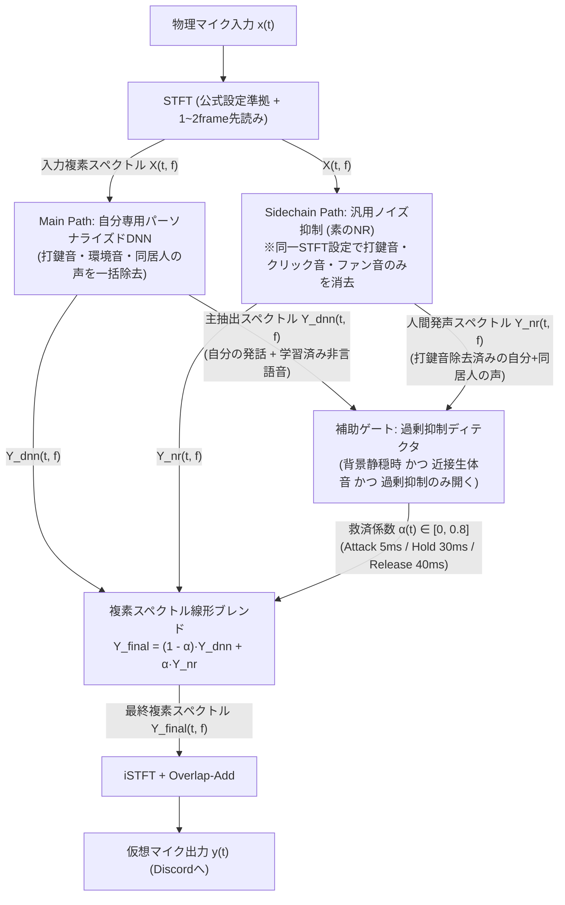

# 01. システム・信号処理アーキテクチャ設計

## 1. リアルタイム要件と遅延バジェット

VC（DiscordのPing 約50ms）において、人間の会話で相槌やテンポに違和感が出ない片道遅延の目安は **150ms以下** です。
学習済みモデルのSTFTサイズを変更すると公開されている事前学習済みの重みが流用できなくなるため、**各ベースモデルの公式STFT設定（先読みフレーム含む）をそのまま使用する遅延バジェット**を採用します。また、モデルを直列に2段繋ぐことによる遅延の加算を避けるため、**並列サイドチェイン構成**とすることでアルゴリズム遅延をモデル1つ分に抑えます。

| モデル構成 | サンプリング周波数 | 窓長 / ホップ長 | 先読み (Lookahead) | アルゴリズム遅延 | バッファ込み実測遅延 |
| :--- | :---: | :---: | :---: | :---: | :---: |
| **GTCRN ベース（Step 1: 高速検証）** | `16,000 Hz` | `32 ms` (512) / `16 ms` (256) | 0〜1 frame (`0〜16 ms`) | **`32 〜 48 ms`** | **`50 〜 70 ms`** |
| **DeepFilterNet3 ベース（Step 2: 48kHz本命）** | `48,000 Hz` | `20 ms` (960) / `10 ms` (480) | 2 frames (`20 ms`) | **`40 ms`** | **`60 〜 75 ms`** |

* **Main Path と Sidechain Path の STFT 統一ルール**:
  出力複素スペクトル同士を線形ブレンドするため、**Main Path と Sidechain Path は必ず同一のSTFT設定（GTCRN同士、またはDeepFilterNet3同士）**で組み合わせます。なお、16kHzのGTCRN構成で48kHzの入出力デバイスと繋ぐ場合は、STFTビンの流用は行わず、16kHzにリサンプリングして処理（またはQMFフィルタバンクで時間波形として低域0〜8kHzと高域に分割）します。

---

## 2. 並列サイドチェイン推論パイプライン全体像

汎用ノイキャンと自分専用モデルを直列に繋ぐと、「①先読み遅延が2倍（40ms→60ms以上）になる」「②学習時と推論時で入力分布が食い違う」「③前段の汎用ノイキャンがため息や息継ぎを消してしまうと後段で戻せない」という問題が生じます。

これを防ぐため、**本線（Main Path）はマイク入力 $X(t, f)$ から直接すべてを分離する単一の自分専用DNN**とし、**汎用ノイキャンはゲート判定と救済ブレンド専用の並列補助経路（Sidechain Path）**として配置します。

---

## 3. 各パスの設計詳細

### 3.1 Main Path: 自分専用パーソナライズドDNN（主役）
* **役割**: 生のマイク入力スペクトル $X(t, f)$ を受け取り、**「自分の声＋自分の非言語音（咳・伸び・笑い・ため息）」を残し、「同居人・友人の声」および「キーボード打鍵音・マウスクリック・環境ノイズ」を一括で消去した複素スペクトル $Y_{\text{dnn}}(t, f)$** を出力します。
* **設計上の大原則**:
  * **主役はあくまで Main Path の DNN** です。学習データのNoise側に打鍵音と同居人の声の両方を含め、Target側に自分の非言語音を含めることで、原則としてこのモデル単体で打鍵音除去も非言語音保持も完結させます。
  * 生の入力 $X(t, f)$ が直接入るため、汎用ノイキャンが消しがちな「ため息・息継ぎ・あくびの息成分」も、自分専用データで学習した通りにそのまま残すことができます。

### 3.2 Sidechain Path: 汎用ノイズ抑制（$Y_{\text{nr}}$）
* **役割**: Main Path と同じアーキテクチャの学習済みノイズ抑制モデル（素の `GTCRN` または素の `DeepFilterNet3`）を並列に走らせ、キーボード打鍵音・マウスクリック・机の振動・ファンノイズなどの「非生体ノイズ」だけを除去した複素スペクトル $Y_{\text{nr}}(t, f)$ を作ります。
* **用途**:
  1. 補助ゲートが「今鳴っている大音量がキーボード打鍵音なのか、人間の生体音（咳や声）なのか」を見分けるための参照入力。
  2. 万が一 Main DNN が未知の激しい咳払いや伸びを削りすぎた瞬間に、打鍵音やファンノイズを混ぜずに生体音だけを補うためのブレンド源。

### 3.3 補助ゲート（基本設計・優先度1）: フェイルセーフ過剰抑制ディテクタ（$\alpha(t)$）
* **役割**: **「背景で同居人が喋っていない（静かな）ときに、口元で出した自分の咳・伸び・あくびを Main DNN が誤って削り落としてしまった瞬間」**だけを救済する安全弁です。
* **フェイルセーフ原則（優先度1：ぶつかったら同居人の声の遮断を最優先し、伸びの削れを許容する）**:
  「自分の伸び・あくび」と「同居人の話し声」が同時にぶつかったとき、無理に補助ゲートを開いて救済しようとすると、$Y_{\text{nr}}$ に含まれる同居人の声が貫通してしまいます。
  そこで基本設計（優先度1）では、**「自分の非言語音と同居人の声がぶつかって分離できない場合は、同居人の声を漏らさないことを最優先し、伸びやあくびが削れることを許容する」**という方針をとります。これにより複雑な時間上限リミッターが不要になり、以下の4つの条件（開放のための3つのAND条件＋開放中の割り込み閉鎖条件）で安全に制御できます。

  1. **背景静穏条件（開く直前に同居人の声が鳴っていないこと）**:
     自分が発声する直前の背景区間（直近 `1.0〜2.0秒` のうち自分が無音のフレーム）において、Sidechain $Y_{\text{nr}}$ の平均エネルギーが背景静穏閾値（同居人が喋っていない時のノイズフロア付近）以下であること。
     * **判定不能時のフェイルセーフ**: 自分が連続して喋り続けた直後にあくびをした場合など、直近 `1.0〜2.0秒` の間に「自分が無音のフレーム」が十分に存在せず背景音量を測定できない場合は、安全側（遮断優先）に倒して「静穏ではない」とみなし、ゲートをロック（$\alpha(t) = 0$）します。
  2. **自己発話レベル基準の近接音量＆近接低域条件**:
     キャリブレーションで測定した自分の通常発話レベル $L_{\text{self}}$（または有音下限 `-45 dBFS` 超の自己発話移動平均レベル）を基準とし、$Y_{\text{nr}}$ の人間発声帯域（100Hz〜4kHz）のパワーが開放開始時は **$L_{\text{self}} - 10\text{ dB}$ 以上**（維持時はヒステリシスにより **$-14\text{ dB}$ 以上**）であり、かつ単一指向性マイク口元配置時の近接低域・高域比 $R_{\text{prox}}$ を満たしていること。
     $$10 \log_{10}\big(E_{\text{voice}}(Y_{\text{nr}}, t)\big) > L_{\text{self}} - 10\text{ dB}\quad (\text{維持時は } -14\text{ dB})$$
  3. **過剰抑制条件（Main DNN がその音を大きく削ってしまっている）**:
     Main DNN の出力パワー $E_{\text{voice}}(Y_{\text{dnn}}, t)$ が、$Y_{\text{nr}}$ のパワーに対して **`-10 dB` 以下**に落ち込んでいること。
     $$10 \log_{10}\left(\frac{E_{\text{voice}}(Y_{\text{dnn}}, t) + \epsilon}{E_{\text{voice}}(Y_{\text{nr}}, t) + \epsilon}\right) < -10\text{ dB}$$
  4. **開放中の割り込み検知とラッチロック（開いた瞬間からのスペクトル変化監視）**:
     同居人の会話の合間（1〜2秒の沈黙）に自分のあくびや伸びが始まってゲートが開き、**伸びの途中で同居人が話を再開したり笑い出したりするケース**への対策です。静かな場面で時間上限によってゲートが切れるのを避けるため、時間制限の代わりに以下のスペクトル変化検知を行います。
     * **基準 $P_{\text{open}}(b)$ の記録**: ゲートが開いた直後の `100〜200 ms` 間における $Y_{\text{nr}}$ の帯域別パワーを基準値 $P_{\text{open}}(b)$ として記録します。
     * **中域ジャンプ検知による即座閉鎖（上限なし）**: ゲートが開いている間、同居人の声が乗る中音域（`500Hz〜2.5kHz`）のパワーを監視し、**近接低域（100〜300Hz）の増加を伴わずに中音域パワーが $P_{\text{open}}$ より `+6 dB` 以上増加した場合**は即座にゲートを閉じます。
     * **再開放ロック（バタつき防止のラッチ）**: 一度この中域ジャンプ検知によって閉じたら、現在の発声が終わって**再び条件1（背景静穏条件）を新たに満たすまでゲートをロック（$\alpha(t) = 0$ 固定）**します。これにより、同居人の会話の抑揚でゲートが開閉を繰り返すバタつき（チャタリング）を完全に防ぎます。
     * **母音変化（「ん〜あ゛〜」「ふぁ〜あ」）時の Main DNN への引き継ぎ**: 自分の伸びやあくびの途中で母音が変わり中音域が $+6\text{ dB}$ 以上上がってゲートが閉じた場合でも、明確な母音フォルマントが出た区間は **Main DNN（$Y_{\text{dnn}}$）自体が自分の声として通す（同時に条件3も不成立となり自然に $\alpha \to 0$ へ移行する）ため、出力が途切れることはありません**。万が一 Phase 4 の評価で母音変化後の区間が削れる現象が見られた場合は、ゲート条件を緩める（漏れの穴を作る）のではなく、その発声パターンを学習データ（パターンC）に追加して Main DNN 側で解決します。

* **エンベロープ時定数（短い Release による話し始めリーク防止）**:
  母音変化で閉じた場合は $Y_{\text{dnn}}$ が音を引き継ぐため短い Release でも途切れ感は出ず、同居人の割り込みで閉じた場合は Release が短いほど同居人の話し始めの漏れを最小化できます。そのため Release は `40 ms` と短く設定します。
  * **Attack**: `5 ms` / **Hold**: `30 ms` / **Release**: `40 ms`

### 3.4 複素スペクトル段階での合成式（基本設計）

同じSTFT設定で動く Main DNN の出力複素スペクトル $Y_{\text{dnn}}(t, f)$ と Sidechain NR の出力複素スペクトル $Y_{\text{nr}}(t, f)$ を線形ブレンドします。

$$Y_{\text{final}}(t, f) = \big(1 - \alpha(t)\big) \cdot Y_{\text{dnn}}(t, f) + \alpha(t) \cdot Y_{\text{nr}}(t, f)$$

---

### 3.5 【拡張仮案（優先度2）】ゲートを周波数帯ごとに分割する方式（$\alpha(t) \to \alpha(t, b)$）

基本設計（優先度1：同居人が喋っている最中は $\alpha(t)=0$ にロックして削れを許容する）を実装・評価した上で、もし**「同居人が喋っている最中に伸びをしたときでも、会話が漏れない範囲で伸びの余韻（低域の唸りや高域の息）をもう少し残したい」**となった場合に試す発展案です。

* **仕組み（帯域ごとの選択的救済）**:
  基本設計の「条件1（背景静穏条件による全帯域ロック）」を緩和する代わりに、周波数を8〜16個のサブバンド（ERBバンド $b$）に分け、**「その帯域で自分の音が同居人の声より圧倒的に勝っている帯域だけを開く」**ように拡張します。
  1. **開く直前の同居人スペクトル包絡 $\hat{P}_{\text{int}}(b)$ の保持**: ゲートが閉じている間の $Y_{\text{nr}}$ の各帯域パワー（直近 `400〜500 ms` の75〜90パーセンタイル包絡）を追跡し、時間トリガー $\alpha_{\text{time}}(t)$（3.3節の条件2・3）が開いた瞬間に $\hat{P}_{\text{int}}(b)$ として固定します。
  2. **帯域別 $\widehat{\mathrm{SIR}}_b(t)$ の算出**:
     $$\widehat{\mathrm{SIR}}_b(t) = 10\log_{10}\left(\frac{\max\big(P_{\text{nr}}(t,b) - \hat{P}_{\text{int}}(b),\; \epsilon\big)}{\hat{P}_{\text{int}}(b) + \epsilon}\right)$$
  3. **低SIR帯域の閉鎖と高SIR帯域の開放**:
     $$\alpha(t, b) = \alpha_{\text{time}}(t) \cdot \mathrm{clip}\!\left(\frac{\widehat{\mathrm{SIR}}_b(t) - 6\,\text{dB}}{15\,\text{dB} - 6\,\text{dB}},\; 0,\; 1\right), \quad \alpha_{\text{time}}(t) \le 0.8$$
     これにより、同居人の声が強い中音域（`500Hz〜2.5kHz`）は $\widehat{\mathrm{SIR}}_b \le 6\text{ dB}$ となって自動的に閉じ（$\alpha(t,b)=0$）、自分の伸びが `+15 dB` 以上勝っている低域・高域だけが開きます。

---

## 4. シナリオ別の挙動まとめ（基本設計・優先度1）

| シナリオ | Main DNN ($Y_{\text{dnn}}$) | Sidechain NR ($Y_{\text{nr}}$) | 補助ゲート ($\alpha(t)$) | 最終出力 $Y_{\text{final}}$ |
| :--- | :--- | :--- | :---: | :--- |
| **① 自分は無言＋ゲームで激しく打鍵＋後ろで同居人が会話** | 打鍵音も同居人の声も消去 (`0.0`) | 打鍵音は消去、同居人の声は残る | **`0.0`** ($Y_{\text{nr}}$ が $L_{\text{self}} - 10\text{dB}$ に届かないため閉じたまま) | **完全無音**。打鍵音も同居人の声も乗らない。 |
| **② 自分が通常発話＋後ろで同居人が会話** | **自分の声のみ抽出** | 自分の声＋同居人の声 | **`0.0`** ($E(Y_{\text{dnn}}) \approx E(Y_{\text{nr}})$ で削られていないため開かない) | **Main DNNが100%働き、自分の声だけがクリアに出力**される。 |
| **③ 同居人が静かな時に、自分が咳・伸び・あくび・ため息をした** | 学習により保持（万が一未知の伸びで削ってもゲートが救済） | 咳・伸び・あくびを保持 | Main DNNが削った場合のみ **`0.8` で時間制限なく開放** | **静かな場面では長い伸びやあくびも途中で一切切れずに最後まで自然に通る**。 |
| **④ 同居人が喋っている最中（または伸びの途中で同居人が喋り始めた時）** | **分離可能な自分の音だけ残し、同居人の声と重なる帯域は消去** | 自分の非言語音＋同居人の声 | **最初から喋っていれば `0.0` でロック。伸びの途中で喋り始めたら中域 `+6dB` 変化検知で即閉鎖＆ラッチロック** | **同居人の声を漏らさないことを最優先（伸びの削れを許容）**。会話の合間に伸びが始まっても同居人の声は貫通しない。 |
| **⑤ 同居人や友人が離れた場所で大声で笑う・叫ぶ** | **部屋残響と距離・声道特徴により消去** (`0.0`) | 同居人の笑い声が残る | **`0.0`** (背景静穏条件および $L_{\text{self}} - 10\text{dB}$・近接低域比で閉鎖維持) | 同居人の大笑いもMain DNNで抑制され、ゲート誤開放によるリークも起きない。 |
| **⑥ 同居人や友人が自分のデスク真横に来て直接話しかけてきた** | （スコープ外） | — | — | VCで会話する状況ではないため、**Discordの手動マイクミュート**で対応する。 |
