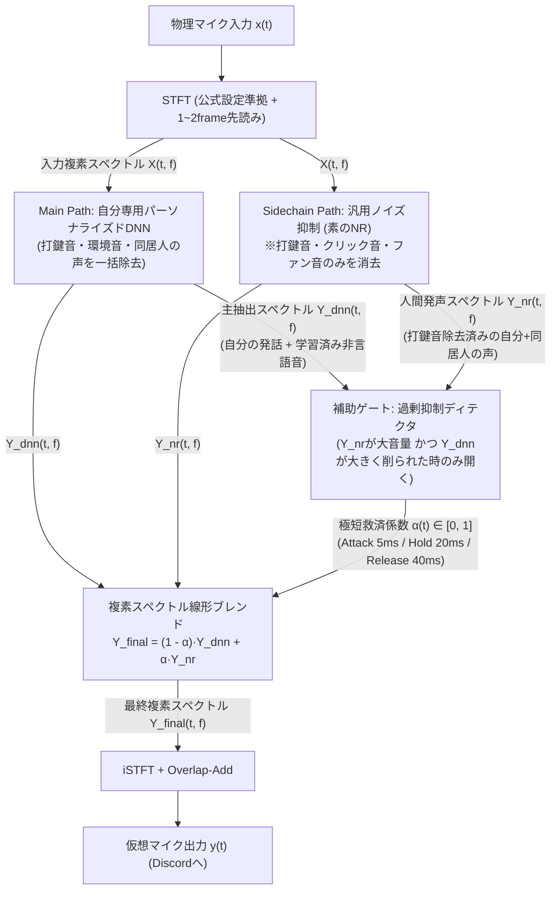

# 01. システム・信号処理アーキテクチャ設計

## 1. リアルタイム要件と遅延バジェット

VC（DiscordのPing 約50ms）において、人間の会話で相槌やテンポに違和感が出ない片道遅延の目安は **150ms以下** です。
学習済みモデルのSTFTサイズを変更すると事前学習済みの重みが流用できなくなるため、**各ベースモデルの公式STFT設定（先読みフレーム含む）をそのまま使用する遅延バジェット**を採用します。また、モデルを直列に2段繋ぐことによる遅延の加算を避けるため、後述する**並列サイドチェイン構成**とすることでアルゴリズム遅延をモデル1つ分に抑えます。

| モデル構成 | サンプリング周波数 | 窓長 / ホップ長 | 先読み (Lookahead) | アルゴリズム遅延 | バッファ込み実測遅延 |
| :--- | :---: | :---: | :---: | :---: | :---: |
| **GTCRN ベース（PoC・軽量構成）** | `16,000 Hz` | `32 ms` (512) / `16 ms` (256) | 0〜1 frame (`0〜16 ms`) | **`32 〜 48 ms`** | **`50 〜 70 ms`** |
| **DeepFilterNet3 ベース（高音質構成）** | `48,000 Hz` | `20 ms` (960) / `10 ms` (480) | 2 frames (`20 ms`) | **`40 ms`** | **`60 〜 75 ms`** |

* **先読み（Lookahead 16〜20ms）の役割**:
  突発的な音が鳴った際、未来の1〜2フレームを見てから「一瞬で減衰するクリック音か、持続する人間の咳・発声か」を判定できるため、発声の頭切れ（アタックの削れ）と誤判定が大幅に減ります。

---

## 2. 並列サイドチェイン推論パイプライン全体像

汎用ノイキャン（Stage 1）と自分専用モデル（Stage 2）を直列に繋ぐと、「①先読み遅延が2倍（40ms→60ms以上）になる」「②学習時と推論時で入力分布が食い違う」「③前段の汎用ノイキャンがため息や息継ぎを消してしまうと後段で戻せない」という3つの問題が生じます。

これを防ぐため、**本線（Main Path）はマイク入力 $X(t, f)$ から直接すべてを分離する単一の自分専用DNN**とし、**汎用ノイキャンはゲート判定と救済ブレンド専用の並列補助経路（Sidechain Path）**として配置します。

---

## 3. 各パスの設計詳細

### 3.1 Main Path: 自分専用パーソナライズドDNN（主役）
* **役割**: 生のマイク入力スペクトル $X(t, f)$ を受け取り、**「自分の声＋自分の非言語音（咳・伸び・笑い・ため息）」を残し、「同居人・友人の声」および「キーボード打鍵音・マウスクリック・環境ノイズ」を一括で消去した複素スペクトル $Y_{\text{dnn}}(t, f)$** を出力します。
* **設計上の大原則**:
  * **主役はあくまで Main Path の DNN** です。学習データのNoise側に打鍵音と同居人の声の両方を含め、Target側に自分の非言語音を含めることで、原則としてこのモデル単体で打鍵音除去も非言語音保持も完結させます。
  * 生の入力 $X(t, f)$ が直接入るため、汎用ノイキャンが消しがちな「ため息・息継ぎ・あくびの息成分」も、自分専用データで学習した通りにそのまま残すことができます。

### 3.2 Sidechain Path: 汎用ノイズ抑制（$Y_{\text{nr}}$）
* **役割**: 既存の学習済みノイズ抑制モデル（素の `GTCRN` や `DeepFilterNet3`）を並列に走らせ、キーボード打鍵音・マウスクリック・机の振動・ファンノイズなどの「非生体ノイズ」だけを除去した複素スペクトル $Y_{\text{nr}}(t, f)$ を作ります。
* **用途**:
  1. 補助ゲートが「今鳴っている大音量がキーボード打鍵音なのか、人間の生体音（咳や声）なのか」を見分けるための参照入力。
  2. 万が一 Main DNN が未知の激しい咳払いや伸びを削りすぎた瞬間に、打鍵音やファンノイズを混ぜずに生体音だけを補うためのブレンド源。
  * ※ 素のノイキャン自体が非言語音をどの程度通すかは、Phase 2のベースライン評価で事前に実測します。

### 3.3 補助ゲート: 過剰抑制ディテクタ（$\alpha(t)$）の設計
* **役割**: **「口元で自分の大きな生体音が鳴っているにもかかわらず、Main DNN がそれを誤って大きく削り落としてしまった（Over-suppression）瞬間」**だけを検知して救済する安全弁です。
* **通常発話時に誤って開かないための差分トリガー条件**:
  単に「$Y_{\text{nr}}$ の音量が大きいとき」という条件にすると、自分が普通に喋っている間も常にゲートが開いてしまい、$Y_{\text{nr}}$ に含まれる同居人の声が混ざってしまいます。
  そこで、以下の**2つの条件を同時に満たしたとき（2フレーム＝20ms連続）のみ**トリガー値 $\tilde{\alpha}(t) > 0$ を出力します。

  1. **近接生体音条件（口元で大きな声・咳が出ている）**:
     打鍵音除去後の $Y_{\text{nr}}(t, f)$ における人間発声帯域（200Hz〜4kHz）のフレームパワー $E_{\text{voice}}(Y_{\text{nr}}, t)$ が、推定遠方背景レベル $L_{\text{far}}(t)$ を **$+12\text{ dB}$ 以上**上回っていること。
     $$10 \log_{10}\big(E_{\text{voice}}(Y_{\text{nr}}, t)\big) > L_{\text{far}}(t) + 12\text{ dB}$$
     * *遠方背景レベル $L_{\text{far}}(t)$ の推定方法*: 直近15秒間のうち、自分が発話していない（$E(Y_{\text{dnn}}) \ll E(Y_{\text{nr}})$ かつ中程度のエネルギーを持つ）フレームの移動パーセンタイル（50%値）として動的更新します（初期値はキャリブレーション時の同居人会話レベル、例 `-38 dBFS`）。
  2. **過剰抑制条件（Main DNN がその音を大きく削ってしまっている）**:
     Main DNN の出力パワー $E_{\text{voice}}(Y_{\text{dnn}}, t)$ が、$Y_{\text{nr}}$ のパワーに対して **`-10 dB` 以下**に落ち込んでいること。
     $$10 \log_{10}\left(\frac{E_{\text{voice}}(Y_{\text{dnn}}, t) + \epsilon}{E_{\text{voice}}(Y_{\text{nr}}, t) + \epsilon}\right) < -10\text{ dB}$$

* **なぜこの2条件（AND）でうまくいくのか**:
  * **自分が普通に喋っているとき**: 条件1は満たしますが、Main DNNは自分の声を正常に通すため $E(Y_{\text{dnn}}) \approx E(Y_{\text{nr}})$（差は $0\text{ dB}$ 付近）となり、**条件2を満たしません**。よって **$\alpha(t) = 0$ のまま**となり、Main DNNのクリアな分離出力が100%使われます。
  * **ゲーム中にキーボードを激しく叩いたとき**: 打鍵音は Sidechain の $Y_{\text{nr}}$ で消去されるため、**条件1を満たさず $\alpha(t) = 0$ のまま**です。
  * **同居人が遠くで喋っているとき**: 音量が $L_{\text{far}}(t) + 12\text{ dB}$ を超えないため、**条件1を満たさず $\alpha(t) = 0$ のまま**です。
  * **自分が口元で激しい咳払いや伸びをして、Main DNNがそれをノイズと誤認して消してしまった瞬間**: 条件1と条件2が同時に成立し、**その瞬間だけ $\alpha(t)$ が立ち上がって咳や伸びを救済**します。

* **極短エンベロープ（Attack / Hold / Release）**:
  咳が止んだ後の余韻で同居人の声が漏れるのを防ぐため、同時マスキングが効いているピーク中だけ開くよう時定数を最小化します（また、連続判定を2フレーム＝20msとすることで先読み20msの範囲内で遅れなく開きます）。
  * **Attack**: `5 ms`
  * **Hold**: `20 ms`
  * **Release**: `40 ms`

### 3.4 複素スペクトル段階での合成式

同じSTFT設定で動く Main DNN の出力複素スペクトル $Y_{\text{dnn}}(t, f)$ と Sidechain NR の出力複素スペクトル $Y_{\text{nr}}(t, f)$ を線形ブレンドします。

$$Y_{\text{final}}(t, f) = \big(1 - \alpha(t)\big) \cdot Y_{\text{dnn}}(t, f) + \alpha(t) \cdot Y_{\text{nr}}(t, f)$$

（Main Path と Sidechain Path の先読みフレーム数を揃えることで、フレーム遅延のズレなしにそのまま加算できます。）

---

## 4. シナリオ別の挙動まとめ

| シナリオ | Main DNN ($Y_{\text{dnn}}$) | Sidechain NR ($Y_{\text{nr}}$) | 補助ゲート ($\alpha(t)$) | 最終出力 $Y_{\text{final}}$ |
| :--- | :--- | :--- | :---: | :--- |
| **① 自分は無言＋ゲームで激しく打鍵＋後ろで同居人が会話** | 打鍵音も同居人の声も消去 (`0.0`) | 打鍵音は消去、同居人の声は残る | **`0.0`** ($Y_{\text{nr}}$ が近接閾値を超えないため閉じたまま) | **完全無音**。打鍵音も同居人の声も乗らない。 |
| **② 自分が通常発話＋後ろで同居人が会話** | **自分の声のみ抽出** | 自分の声＋同居人の声 | **`0.0`** ($E(Y_{\text{dnn}}) \approx E(Y_{\text{nr}})$ で削られていないため開かない) | **Main DNNが100%働き、自分の声だけがクリアに出力**される。 |
| **③ 自分が咳・伸び・ため息をした（Main DNNが正常に保持できた場合）** | **学習により咳・伸び・ため息を保持** | 咳・伸びを保持 | **`0.0`** (Main DNNが削っていないためゲート不要) | Main DNNから自然な非言語音がそのまま出力される。 |
| **④ 自分が未知の激しい咳・伸びをしてMain DNNが誤って削ってしまった瞬間** | 誤って減衰 (`< -10dB`) | 自分の咳・伸びが残っている | **ピークの瞬間のみ `0.5 ~ 0.8`** (近接大音量 かつ 過剰抑制を検知) | $Y_{\text{nr}}$ がブレンドされて咳・伸びが救済される。Hold 20ms / Release 40ms で即座に閉じるため余韻での他人声漏れもない。 |
