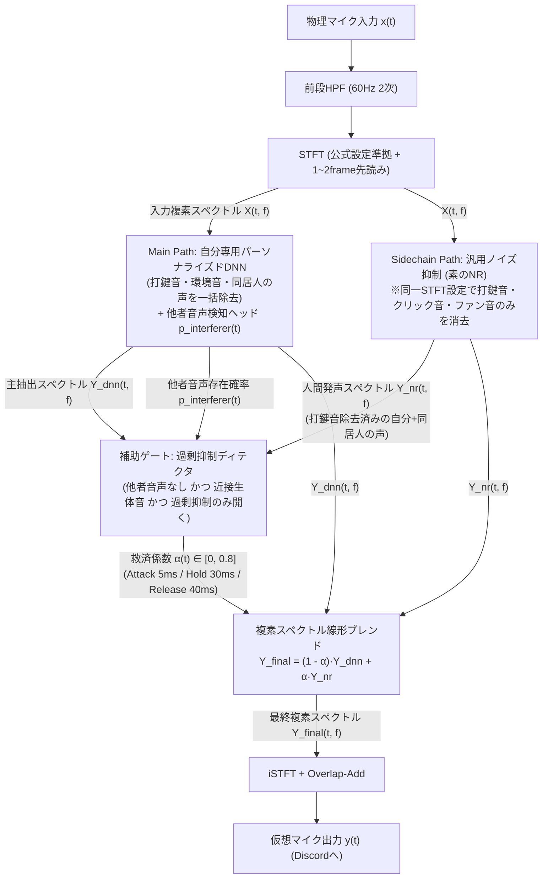

# 01. システム・信号処理アーキテクチャ設計

## 1. リアルタイム要件と遅延バジェット

VC（DiscordのPing 約50ms）において、人間の会話で相槌やテンポに違和感が出ない片道遅延の目安は **150ms以下** です。
学習済みモデルのSTFTサイズを変更すると公開されている事前学習済みの重みが流用できなくなるため、**各ベースモデルの公式STFT設定（先読みフレーム含む）をそのまま使用する遅延バジェット**を採用します。また、モデルを直列に2段繋ぐことによる遅延の加算を避けるため、**並列サイドチェイン構成**とすることでアルゴリズム遅延をモデル1つ分に抑えます。

| モデル構成 | サンプリング周波数 | 窓長 / ホップ長 | 先読み (Lookahead) | アルゴリズム遅延 | バッファ込み実測遅延 | 用途 |
| :--- | :---: | :---: | :---: | :---: | :---: | :--- |
| **GTCRN ベース（Step 1）** | `16,000 Hz` | `32 ms` (512) / `16 ms` (256) | 0〜1 frame (`0〜16 ms`) | **`32 〜 48 ms`** | — | **オフライン検証専用**（データ配合・損失・ゲートロジックの検証） |
| **DeepFilterNet3 ベース（Step 2）** | `48,000 Hz` | `20 ms` (960) / `10 ms` (480) | 2 frames (`20 ms`) | **`40 ms`** | **`60 〜 75 ms`** | **リアルタイム運用（Phase 5）** |

* **Step 1 はオフライン検証専用とする**:
  リアルタイム経路（Phase 5）は48kHzネイティブの DeepFilterNet3 のみで構成します。16kHz の GTCRN を48kHz入出力デバイスに繋ぐための QMF 帯域分割・リサンプリング処理は実装しません。
* **Main Path と Sidechain Path の STFT 統一ルール**:
  出力複素スペクトル同士を線形ブレンドするため、**Main Path と Sidechain Path は必ず同一のSTFT設定（GTCRN同士、またはDeepFilterNet3同士）**で組み合わせます。
* **前段ハイパスフィルタ（HPF）**:
  口元近接配置では破裂音（`/p/`, `/b/`）やため息の風圧で `20〜80 Hz` に大振幅の吹かれが乗りやすいため、STFT前段に **`60 Hz` の2次 Butterworth HPF** を入れます（物理ウインドスクリーンと併用）。近接低域判定（`100〜280 Hz`）への影響を抑えるため、カットオフは `80 Hz` ではなく `60 Hz` 寄りとします。
  * **学習データ・評価データにも同一のHPFを適用**し、推論時と入力分布を揃えます（`02_model_and_dataset.md §2.3`）。

---

## 2. 並列サイドチェイン推論パイプライン全体像

汎用ノイキャンと自分専用モデルを直列に繋ぐと、「①先読み遅延が2倍（40ms→60ms以上）になる」「②学習時と推論時で入力分布が食い違う」「③前段の汎用ノイキャンがため息や息継ぎを消してしまうと後段で戻せない」という問題が生じます。

これを防ぐため、**本線（Main Path）はマイク入力 $X(t, f)$ から直接すべてを分離する単一の自分専用DNN**とし、**汎用ノイキャンはゲート判定と救済ブレンド専用の並列補助経路（Sidechain Path）**として配置します。

---

## 3. 各パスの設計詳細

### 3.1 Main Path: 自分専用パーソナライズドDNN（主役）
* **役割**: 生のマイク入力スペクトル $X(t, f)$ を受け取り、**「自分の声＋自分の非言語音（咳・伸び・笑い・ため息）」を残し、「同居人・友人の声」および「キーボード打鍵音・マウスクリック・環境ノイズ」を一括で消去した複素スペクトル $Y_{\text{dnn}}(t, f)$** を出力します。
* **設計上の大原則**:
  * **主役はあくまで Main Path の DNN** です。学習データのNoise側に打鍵音と同居人の声の両方を含め、Target側に自分の非言語音を含めることで、原則としてこのモデル単体で打鍵音除去も非言語音保持も完結させます。
  * 生の入力 $X(t, f)$ が直接入るため、汎用ノイキャンが消しがちな「ため息・息継ぎ・あくびの息成分」も、自分専用データで学習した通りにそのまま残すことができます。
* **他者音声検知ヘッド $p_{\text{interferer}}(t)$**:
  * Main DNN のボトルネック特徴（GRU出力等）から **線形層1枚＋Sigmoid** で、「現在のフレームに遠方・残響を伴う他者音声が存在する確率 $p_{\text{interferer}}(t) \in [0, 1]$」を毎フレーム出力します（追加パラメータ `< 500`、追加遅延 `0 ms`）。
  * 学習データの動的ミキサーがフレームごとの他者音声の有無を把握しているため、追加収録なしで Binary Cross-Entropy 損失により同時学習できます（ラベル定義は `02_model_and_dataset.md §2.4`、損失は §3）。
  * 補助ゲートは、DSPによる背景推定やスペクトル変化検知の代わりにこの出力を使って「同居人が喋っているか」を判定します（§3.3）。自分が喋っている最中や、自分の伸び・あくびが鳴っている最中でも判定できる点が DSP 方式との違いです。

### 3.2 Sidechain Path: 汎用ノイズ抑制（$Y_{\text{nr}}$）
* **役割**: Main Path と同じアーキテクチャの学習済みノイズ抑制モデル（素の `GTCRN` または素の `DeepFilterNet3`）を並列に走らせ、キーボード打鍵音・マウスクリック・机の振動・ファンノイズなどの「非生体ノイズ」だけを除去した複素スペクトル $Y_{\text{nr}}(t, f)$ を作ります。
* **用途**:
  1. 補助ゲートが「今鳴っている大音量がキーボード打鍵音なのか、人間の生体音（咳や声）なのか」を見分けるための参照入力。
  2. 万が一 Main DNN が未知の激しい咳払いや伸びを削りすぎた瞬間に、打鍵音やファンノイズを混ぜずに生体音だけを補うためのブレンド源。

### 3.3 補助ゲート（基本設計・優先度1）: フェイルセーフ過剰抑制ディテクタ（$\alpha(t)$）
* **役割**: **「背景で同居人が喋っていない（静かな）ときに、口元で出した自分の咳・伸び・あくびを Main DNN が誤って削り落としてしまった瞬間」**だけを救済する安全弁です。
* **フェイルセーフ原則（優先度1：ぶつかったら同居人の声の遮断を最優先し、伸びの削れを許容する）**:
  「自分の伸び・あくび」と「同居人の話し声」が同時にぶつかったとき、無理に補助ゲートを開いて救済しようとすると、$Y_{\text{nr}}$ に含まれる同居人の声が貫通してしまいます。
  そこで基本設計（優先度1）では、**「自分の非言語音と同居人の声がぶつかって分離できない場合は、同居人の声を漏らさないことを最優先し、伸びやあくびが削れることを許容する」**という方針をとります。
* **ゲートの状態遷移**: ゲートは「開放条件（Open）」と「維持条件（Hold）」を分けて評価します。開放条件は**開く瞬間に一度だけ判定してラッチ**し、開いている間は維持条件のみを毎フレーム評価します。

#### 3.3.1 開放条件（Open：3条件すべてを満たした瞬間に開く）

1. **他者音声不在条件（直近で同居人が喋っていないこと）**:
   直近 `1.0 秒` 間のすべてのフレームで $p_{\text{interferer}}(t) < \tau_{\text{int}}$ であること。
   * $p_{\text{interferer}}$ は自分が喋っている最中も評価できるため、**自分の発話直後（`0〜0.5秒` 以内）の引き笑い・咳払い・ため息も、同居人が黙っていれば救済対象になります**。
   * $\tau_{\text{int}}$ は Phase 4 で、半実録テストセット上の誤検知率と検出率から決めます（`02_model_and_dataset.md §4` 指標6）。
2. **近接生体音条件（口元で大きな生体音が鳴っていること）**:
   以下の **音量条件** と **近接スペクトル条件（2系統 OR）** をともに満たすこと。
   * **音量条件**: $Y_{\text{nr}}$ の人間発声帯域（`100 Hz〜4 kHz`）のパワーが $L_{\text{self}} - 10\text{ dB}$ 以上であること。
     $$10 \log_{10}\big(E_{\text{voice}}(Y_{\text{nr}}, t)\big) > L_{\text{self}} - 10\text{ dB}$$
     * $L_{\text{self}}$ は**キャリブレーションで測定した自分の通常発話の平均RMSレベル（固定値）**とし、オンライン自動更新は行いません。マイクと口元距離は固定する前提のため自動更新は不要であり、同居人の大笑いが混入して閾値が緩む事故を防げます。マイクゲインを変更した場合は再キャリブレーションします。
   * **近接スペクトル条件（以下のいずれか）**:
     * **(a) 有声近接条件**: `100〜280 Hz` / `500〜2500 Hz` のパワー比が閾値 $\theta_{\text{voiced}}$ 以上（近接効果による低域強調。有声の伸び・唸り・母音あくびを捕捉）。
     * **(b) 無声オンアクシス気流条件**: `4〜12 kHz` / `500〜2500 Hz` のパワー比が閾値 $\theta_{\text{unvoiced}}$ 以上、**かつ** 中域の調波性（Harmonicity）が閾値以下（口元正面の無声のため息「はぁ〜」・乾いた咳「コホッ」・息笑いを捕捉）。遠方の同居人の大笑い・叫び声は有声調波成分が強く、オフアクシス特性と部屋反射で `4 kHz` 以上も減衰するため、この条件は満たしません。
3. **過剰抑制条件（Main DNN がその音を大きく削ってしまっていること）**:
   Main DNN の出力パワー $E_{\text{voice}}(Y_{\text{dnn}}, t)$ が、$Y_{\text{nr}}$ のパワーに対して **`-10 dB` 以下**に落ち込んでいること。
   $$10 \log_{10}\left(\frac{E_{\text{voice}}(Y_{\text{dnn}}, t) + \epsilon}{E_{\text{voice}}(Y_{\text{nr}}, t) + \epsilon}\right) < -10\text{ dB}$$
   * これにより、Main DNN が自分の声や非言語音を正常に通している時は $\alpha(t) = 0$ のままになります。

#### 3.3.2 維持条件（Hold：開放中に毎フレーム評価）

* **他者音声の割り込み検知（最優先・即時閉鎖）**:
  開放中に1フレームでも $p_{\text{interferer}}(t) \ge \tau_{\text{int}}$ となった場合は、即座にゲートを閉じます。伸び・あくびの途中で同居人が話し始めたり笑い出したりするケースへの対策です。
* **音量の維持（ヒステリシス）**: $Y_{\text{nr}}$ の人間発声帯域パワーが $L_{\text{self}} - 14\text{ dB}$ 以上であること（伸びやあくびの途中の音量の揺らぎで途切れないため、開放時より `4 dB` 緩める）。
* **過剰抑制の継続**: 開放条件3が成り立ち続けていること。Main DNN が音を通し始めたら（母音に変わった区間など）、通常の Release で $\alpha \to 0$ に戻ります。
* **開放条件1（直近1秒の他者音声不在）は開放中に再評価しません**。開いた後は上記の割り込み検知のみで判定します。

#### 3.3.3 再開放ロック（バタつき防止のラッチ）

割り込み検知によって閉じた場合は、**$p_{\text{interferer}}(t) < \tau_{\text{int}}$ が再び `1.0 秒` 連続するまでゲートをロック（$\alpha(t) = 0$ 固定）**します。これにより、同居人の会話の抑揚でゲートが開閉を繰り返すバタつき（チャタリング）を防ぎます。

#### 3.3.4 エンベロープ時定数と時間上限
* **Attack**: `5 ms` / **Hold**: `30 ms` / **Release**: `40 ms`
  * 割り込み検知で閉じた場合は Release が短いほど同居人の話し始めの漏れを抑えられ、母音変化などで条件3が外れて閉じた場合は $Y_{\text{dnn}}$ が音を引き継ぐため、短い Release でも途切れ感は出ません。
* **時間上限は設けません**。同居人が喋り始めない限り、何秒の長い伸びやあくびでも途中で切れることなく開放（上限 $\alpha_{\max} = 0.8$）を維持します。

#### 3.3.5 調整パラメータ（Phase 3〜4 で自分のデータから決定）

| パラメータ | 初期値（目安） | 決め方 |
| :--- | :---: | :--- |
| $\tau_{\text{int}}$ | `0.5` | 半実録テストセットで、伸びより `-15 dB` の同居人の声の検出率と、静穏時の非言語音での誤検知率から決定 |
| $L_{\text{self}}$ | キャリブレーション値 | 自分の通常発話の平均RMSレベル（固定） |
| $\theta_{\text{voiced}}$, $\theta_{\text{unvoiced}}$, 調波性閾値 | — | 自分の非言語音（有声・無声）と、放置録音中の同居人の大笑いの分布から、両者を分ける値に設定 |

#### 3.3.6 （参考）$p_{\text{interferer}}$ を使わず DSP だけで割り込みを検知する案を採用しない理由
開放中の中域パワーが「開いた瞬間より `+6 dB` 以上上がったら閉じる」という DSP 方式は、無相関な音の電力加算で
$$\Delta L = 10\log_{10}\!\left(1 + \frac{P_{\text{int}}}{P_{\text{open}}}\right) \ge 6\text{ dB} \iff P_{\text{int}} \ge 2.98\,P_{\text{open}}$$
となり、**同居人の声が自分の伸びより `+4.7 dB` 以上大きくないと発火しません**。一方で、漏れが同時マスキングで聞こえなくなるのは同居人の声が自分の音より `15 dB` 程度小さいときであり、その間の約 `20 dB` の範囲では「漏れは聞こえるのに検出されない」不感帯が生じます。閾値を下げると伸び自体の音量の揺らぎで誤閉鎖するため、DSP の調整では解決できず、$p_{\text{interferer}}$ を採用します。

### 3.4 複素スペクトル段階での合成式（基本設計）

同じSTFT設定で動く Main DNN の出力複素スペクトル $Y_{\text{dnn}}(t, f)$ と Sidechain NR の出力複素スペクトル $Y_{\text{nr}}(t, f)$ を線形ブレンドします。

$$Y_{\text{final}}(t, f) = \big(1 - \alpha(t)\big) \cdot Y_{\text{dnn}}(t, f) + \alpha(t) \cdot Y_{\text{nr}}(t, f)$$

* **位相干渉について**: Main DNN が抑制にいく際に $\angle Y_{\text{dnn}}$ が $\angle Y_{\text{nr}}$ から回転していると、$\alpha$ の遷移中に逆相の打ち消しが起きる可能性があります。ただしゲートが開くのは $|Y_{\text{dnn}}|$ が $|Y_{\text{nr}}|$ より `10 dB` 以上小さいとき（開放条件3）なので影響は小さいと見込まれます。聴感確認で違和感があった場合のみ、「振幅は線形ブレンドし、$\cos(\angle Y_{\text{dnn}} - \angle Y_{\text{nr}}) < 0$ のビンでは救済側の位相 $\angle Y_{\text{nr}}$ を使う極座標ブレンド」を検討します。

---

### 3.5 【拡張仮案（優先度2）】ゲートを周波数帯ごとに分割する方式（$\alpha(t) \to \alpha(t, b)$）

基本設計（優先度1：同居人が喋っている最中は $\alpha(t)=0$ にロックして削れを許容する）を実装・評価した上で、もし**「同居人が喋っている最中に伸びをしたときでも、会話が漏れない範囲で伸びの余韻（低域の唸りや高域の息）をもう少し残したい」**となった場合に試す発展案です。

* **仕組み（帯域ごとの選択的救済）**:
  基本設計の「開放条件1（他者音声不在による全帯域ロック）」を緩和する代わりに、周波数を8〜16個のサブバンド（ERBバンド $b$）に分け、**「その帯域で自分の音が同居人の声より圧倒的に勝っている帯域だけを開く」**ように拡張します。
  1. **開く直前の同居人スペクトル包絡 $\hat{P}_{\text{int}}(b)$ の保持**: ゲートが閉じている間の $Y_{\text{nr}}$ の各帯域パワー（直近 `400〜500 ms` の75〜90パーセンタイル包絡）を追跡し、時間トリガー $\alpha_{\text{time}}(t)$（3.3.1節の条件2・3）が開いた瞬間に $\hat{P}_{\text{int}}(b)$ として固定します。
  2. **帯域別 $\widehat{\mathrm{SIR}}_b(t)$ の算出**:
     $$\widehat{\mathrm{SIR}}_b(t) = 10\log_{10}\left(\frac{\max\big(P_{\text{nr}}(t,b) - \hat{P}_{\text{int}}(b),\; \epsilon\big)}{\hat{P}_{\text{int}}(b) + \epsilon}\right)$$
  3. **低SIR帯域の閉鎖と高SIR帯域の開放**:
     $$\alpha(t, b) = \alpha_{\text{time}}(t) \cdot \mathrm{clip}\!\left(\frac{\widehat{\mathrm{SIR}}_b(t) - 6\,\text{dB}}{15\,\text{dB} - 6\,\text{dB}},\; 0,\; 1\right), \quad \alpha_{\text{time}}(t) \le 0.8$$
     これにより、同居人の声が強い中音域（`500Hz〜2.5kHz`）は $\widehat{\mathrm{SIR}}_b \le 6\text{ dB}$ となって自動的に閉じ（$\alpha(t,b)=0$）、自分の伸びが `+15 dB` 以上勝っている低域・高域だけが開きます。
* **固定包絡の限界と $p_{\text{interferer}}$ との連動**:
  開放後に同居人の発話が別の母音・子音へ移ってフォルマント帯域が移動すると、移動先バンドの $\hat{P}_{\text{int}}(b)$ が過小評価されて開いてしまう懸念があります。そのため固定包絡単体には頼らず、**開放中に $p_{\text{interferer}}(t)$ が開放時点から急上昇した場合（同居人の発話の再開・音量増加）は $\hat{P}_{\text{int}}(b)$ を更新するか $\alpha_{\text{time}}$ を閉じる**など、$p_{\text{interferer}}$ と連動させて設計します。

---

## 4. シナリオ別の挙動まとめ（基本設計・優先度1）

| シナリオ | Main DNN ($Y_{\text{dnn}}$) | Sidechain NR ($Y_{\text{nr}}$) | 補助ゲート ($\alpha(t)$) | 最終出力 $Y_{\text{final}}$ |
| :--- | :--- | :--- | :---: | :--- |
| **① 自分は無言＋ゲームで激しく打鍵＋後ろで同居人が会話** | 打鍵音も同居人の声も消去 (`0.0`) | 打鍵音は消去、同居人の声は残る | **`0.0`**（$p_{\text{interferer}}$ が高く、$Y_{\text{nr}}$ も $L_{\text{self}} - 10\text{dB}$ に届かないため閉じたまま） | **完全無音**。打鍵音も同居人の声も乗らない。 |
| **② 自分が通常発話＋後ろで同居人が会話** | **自分の声のみ抽出** | 自分の声＋同居人の声 | **`0.0`**（$E(Y_{\text{dnn}}) \approx E(Y_{\text{nr}})$ で削られておらず、$p_{\text{interferer}}$ も高い） | **Main DNNが100%働き、自分の声だけがクリアに出力**される。 |
| **③ 同居人が静かな時に、自分が咳・伸び・あくび・ため息をした（自分の発話直後を含む）** | 学習により保持（万が一未知の伸びで削ってもゲートが救済） | 咳・伸び・あくびを保持 | Main DNNが削った場合のみ **`0.8` で時間制限なく開放**（有声は条件2(a)、無声のため息・乾いた咳は条件2(b)で捕捉） | **静かな場面では長い伸びやあくびも、喋った直後の引き笑いや咳払いも自然に通る**。 |
| **④ 同居人が喋っている最中（または伸びの途中で同居人が喋り始めた時）** | **分離可能な自分の音だけ残し、同居人の声と重なる帯域は消去** | 自分の非言語音＋同居人の声 | **最初から喋っていれば開放条件1で `0.0`。伸びの途中で喋り始めたら $p_{\text{interferer}}$ の割り込み検知で即閉鎖＆ラッチロック** | **同居人の声を漏らさないことを最優先（伸びの削れを許容）**。会話の合間に伸びが始まっても同居人の声は貫通しない。 |
| **⑤ 同居人や友人が離れた場所で大声で笑う・叫ぶ** | **部屋残響と距離・声道特徴により消去** (`0.0`) | 同居人の笑い声が残る | **`0.0`**（$p_{\text{interferer}}$、$L_{\text{self}} - 10\text{dB}$、近接スペクトル条件のいずれでも弾かれる） | 同居人の大笑いもMain DNNで抑制され、ゲート誤開放によるリークも起きない。 |
| **⑥ 同居人や友人が自分のデスク真横に来て直接話しかけてきた** | （スコープ外） | — | — | VCで会話する状況ではないため、**Discordの手動マイクミュート**で対応する。 |
